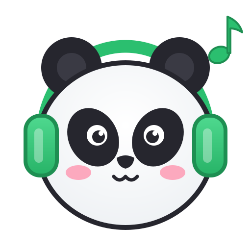
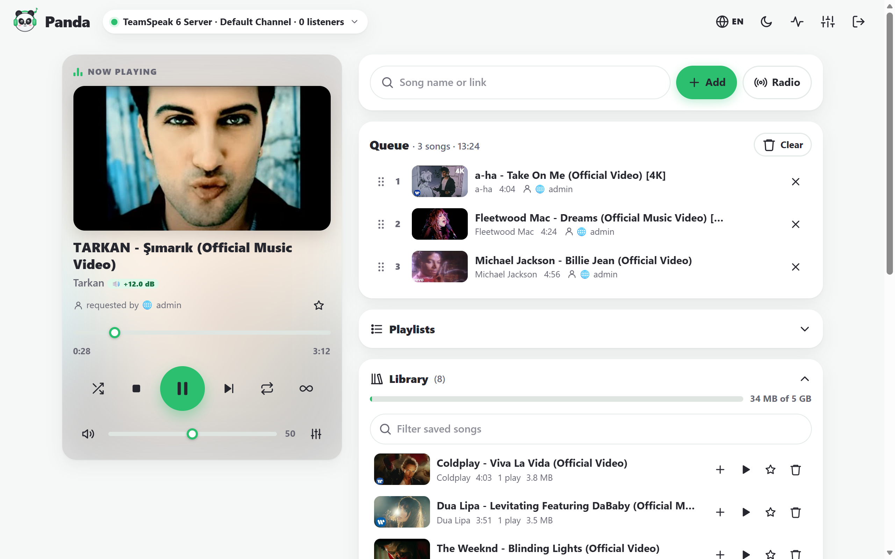
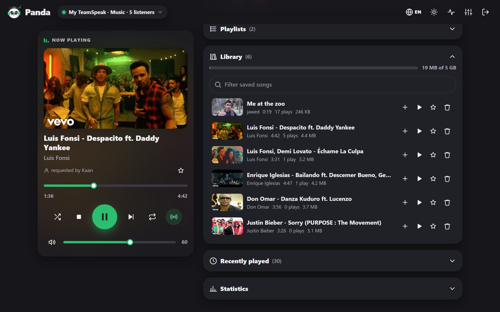
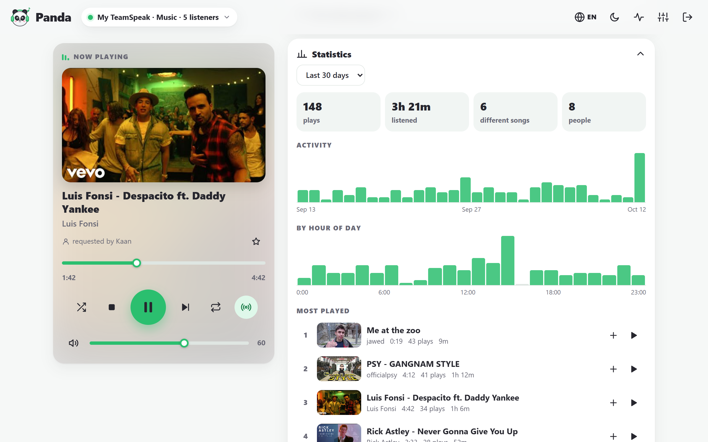
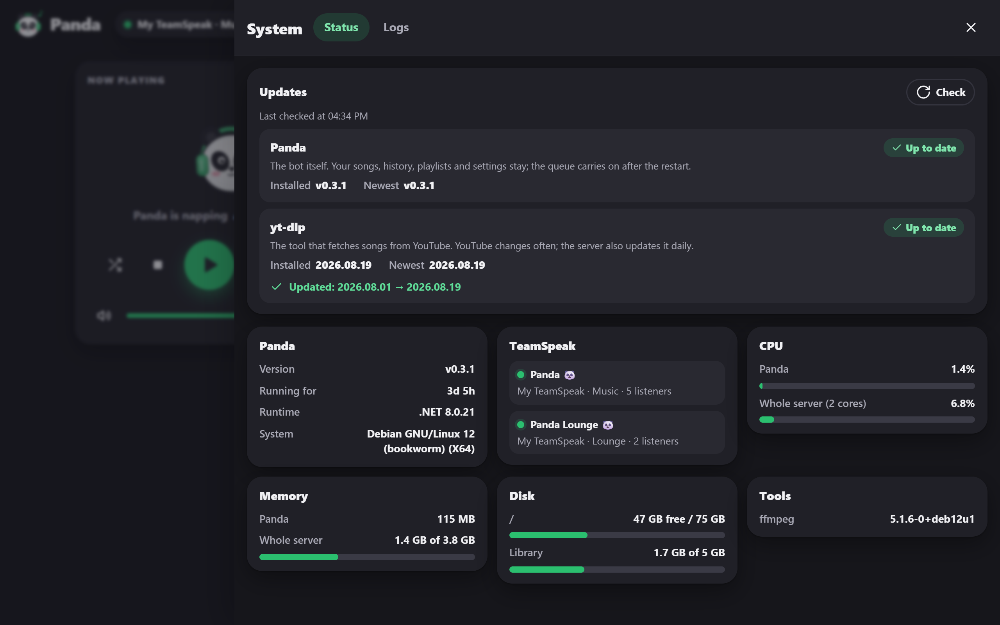
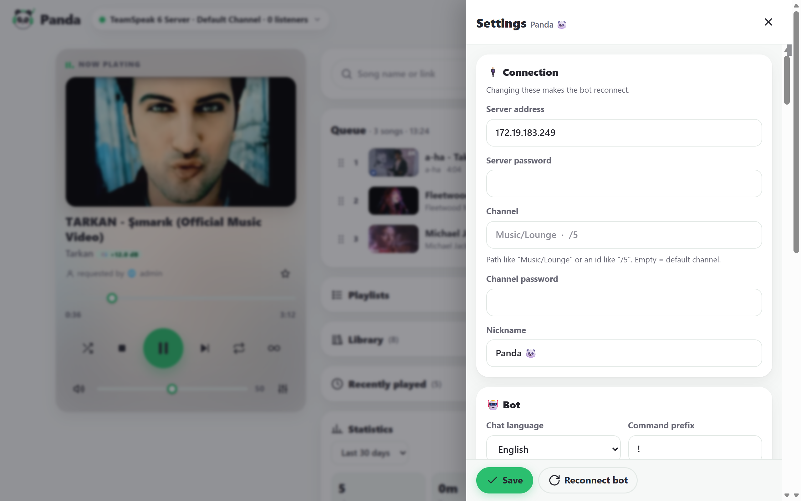

<p align="center">
  
</p>

<h1 align="center">Panda 🐼</h1>

<p align="center">
  A tiny, cute YouTube music bot for <b>TeamSpeak 6</b> — with a lovely web panel.<br>
  <a href="https://kaanbahasever.github.io/panda/">Website</a> ·
  <a href="README.tr.md">Türkçe</a>
</p>

<p align="center">
  <a href="https://github.com/KaanBahaSever/panda/releases"></a>
  <a href="LICENSE"></a>
  
</p>

---

Panda joins your TeamSpeak server and plays music from YouTube. Type `!play` and a song name or link
in the chat, or use the web panel. No plugins, no scripts, no TeamSpeak client running in the background:
Panda talks to the server directly, so it stays light: the bot itself uses about 130 MB of RAM, and
`yt-dlp` + `ffmpeg` only run while a song is playing.



## Features

- 🎵 **YouTube only, done well** — search by name or paste any link: `youtube.com`, `youtu.be`,
  **YouTube Music**, Shorts. Playlist and album links add just one song (the one in the link,
  or the first one of the list) instead of loading the whole list.
- 📚 **Song library** — every song you request is saved on disk. Songs you play again start instantly
  and never touch YouTube again; when the library is full, the least played songs make room.
- ⚡ **No waiting between songs** — the next songs in the queue are downloaded ahead of time.
- 📻 **Radio** — when the queue runs out, Panda keeps playing songs like the last one (YouTube's Mix).
  Off by default; `!radio` or the radio button turns it on.
- 🔊 **Equal loudness** — saved songs are measured once and play equally loud.
- 📃 **Playlists & favorites** — save the queue or single songs into playlists, play them with
  `!playlist <name>`, star a song with `!fav`.
- 🤖 **Several bots, one panel** — each bot has its own server, channel, queue and settings; they share
  one song library.
- 🐼 **Made for TeamSpeak 6** (TS3 servers work too).
- 🌐 **Web panel** — now playing, queue with drag & drop, search, library, playlists, history with
  times, statistics, volume, loop, seek, light/dark theme, English/Turkish/French/German.
- 👥 **Panel users** — admins can do everything; "can only add songs" users watch and add songs.
- 🩺 **System screen** — CPU, memory and disk, each bot's connection, live logs with search, and
  updates (one click on Linux installs).
- 💬 **Chat commands** in English, Turkish, French and German. `!follow` makes the bot follow you between channels.
- 🍪 **YouTube bot check?** Paste your cookies in the panel and you're done.
- 🔁 Reconnects by itself, keeps its identity (so permissions stick), shows the song in its description.
- 🔐 Servers that ask for a higher identity security level work too: Panda raises its own once (a few seconds to a few minutes).
- 📦 One file, one command to install. Runs on Linux (x64/ARM), Windows, macOS and Docker.
- 🔑 **No YouTube API key needed.**

## Song library

Every song that is requested is saved in the library folder (`/var/lib/panda/library`), up to a size
limit you choose (5 GB by default). When the limit is reached, Panda deletes the songs that were played
the least, so your favourites stay. While a song is in the library:

- it starts immediately (no YouTube request at all),
- `!play` finds it by name too — `!play bohemian` plays your saved *Bohemian Rhapsody*,
- it shows up in the panel's **Library**, where you can play, queue or delete it.

Saving can be turned off in **Settings → Library**; Panda then only downloads the next two songs ahead
of time and deletes them after playing.



## Statistics and the System screen

The **Statistics** card shows what was played: plays, time listened, activity by day and hour, the most
played songs and who asked for the most. Admins also get a **System** screen with CPU, memory and disk,
every bot's connection, live logs and updates.





## Install (Linux)

```bash
curl -fsSL https://raw.githubusercontent.com/KaanBahaSever/panda/main/scripts/install.sh | sudo bash
```

The installer asks for your TeamSpeak server address and the panel port, installs `ffmpeg`, `yt-dlp`
and `deno`, sets up a systemd service and prints the panel address and login. To update, use
**System → Updates** in the panel, or run the installer again. Updates keep your songs, history,
playlists and settings, and the bots carry on with their queue where they left off.

```bash
journalctl -u panda -f                    # logs
sudo systemctl restart panda              # restart
curl -fsSL https://raw.githubusercontent.com/KaanBahaSever/panda/main/scripts/install.sh | sudo bash -s -- --uninstall
```

`yt-dlp` updates itself every day (YouTube changes often and old versions stop working); the panel's
**System** screen can also update it right away.

### Docker

```bash
git clone https://github.com/KaanBahaSever/panda && cd panda
docker compose up -d
docker compose logs panda                 # shows the panel login on first start
```

To update: `git pull && docker compose up -d --build`.

### Windows / macOS

Download the archive for your system from [Releases](https://github.com/KaanBahaSever/panda/releases),
install [ffmpeg](https://ffmpeg.org/download.html), [yt-dlp](https://github.com/yt-dlp/yt-dlp#installation) and
[deno](https://deno.com/) so they are on your `PATH`, then run `panda` (`panda.exe`). Settings are stored
in a `data` folder next to where you start it.

## First steps

1. Open the panel (`http://your-server:8080`) and log in as `admin` with the printed password.
2. **Settings → Connection**: server address (`ts.example.com` or `1.2.3.4:9987`), server password,
   channel. The bot reconnects when you save.
3. Change the panel password under **Settings**, and add users for your friends if you like.
4. In TeamSpeak, write `!play never gonna give you up` in the bot's channel. 🎶



## Chat commands

Write them in the bot's channel or in a private message to the bot.

| Command | Turkish | French | German | What it does |
|---|---|---|---|---|
| `!play <name or link>` / `!p` | `!çal` | `!jouer` | `!spielen` | Play now, or add to the queue |
| `!playnow <name or link>` | `!şimdiçal` | `!jouermaintenant` | `!jetztspielen` | Skip the queue and play right away |
| `!skip` / `!next` | `!geç` | `!passer` / `!suivant` | `!überspringen` | Next song |
| `!stop` | `!dur` | `!arrêt` | `!stopp` | Stop and clear the queue |
| `!pause` / `!resume` | `!duraklat` / `!devam` | `!pause` / `!reprendre` | `!pause` / `!fortsetzen` | Pause / continue |
| `!queue` / `!q` | `!sıra` | `!file` | `!warteschlange` | Show the queue |
| `!np` | `!şimdi` | `!encours` | `!läuft` | What's playing |
| `!vol <0-100>` | `!ses` | `!volume` | `!lautstärke` | Volume |
| `!loop <off\|one\|all>` | `!tekrar <kapalı\|şarkı\|hepsi>` | `!boucle <non\|un\|tout>` | `!wiederholen <aus\|eins\|alle>` | Repeat |
| `!shuffle` | `!karıştır` | `!mélanger` | `!mischen` | Shuffle the queue |
| `!remove <#>` / `!clear` | `!sil` / `!temizle` | `!retirer` / `!vider` | `!entfernen` / `!leeren` | Remove a song / clear the queue |
| `!join` | `!gel` | `!viens` | `!komm` | Come to my channel |
| `!follow` | `!takip` | `!suivre` | `!folgen` | Follow me between channels (again to stop) |
| `!radio <on\|off>` | `!radyo <aç\|kapat>` | `!radio <oui\|non>` | `!radio <an\|aus>` | Keep playing similar songs when the queue ends |
| `!playlist <name>` / `!pl` | `!liste <ad>` | `!playlist` | `!playlist` | Queue a saved playlist |
| `!playlists` | `!listeler` | `!playlists` | `!playlists` | List saved playlists |
| `!fav` | `!fav` | `!fav` | `!fav` | Save the song playing to Favorites |
| `!search <name>` | `!ara` | `!chercher` | `!suchen` | Show 5 results; `!1` … `!5` picks one |
| `!seek <1:30 \| +10 \| -10>` | `!sar` | `!aller` | `!spulen` | Jump in the song |
| `!back` | `!önceki` | `!précédent` | `!zurück` | Play the previous song again |
| `!skipto <#>` | `!git` | `!allerà` | `!springen` | Jump to a song in the queue |
| `!move <#> <#>` | `!taşı` | `!déplacer` | `!verschieben` | Move a song in the queue |
| `!voteskip` | `!oyla` | `!voter` | `!abstimmen` | Vote to skip someone else's song (when voting is on) |
| `!help` | `!yardım` | `!aide` | `!hilfe` | List commands |

### Who may do what

By default everyone can use every command. **Settings → Chat permissions** changes that:

- **Admins** and **DJs**: pick people or server groups from the server (or paste a unique ID). Admins can do everything.
- **Everyone on the server can use the bot**: turn it off and only DJs and admins are answered.
- **Blocked**: people the bot never answers.
- **Who may use each command**: everyone, DJs or admins, per command. **Use the recommended setup** leaves
  adding songs and voting to everyone and gives pausing, volume, the queue and the rest to DJs.
- **Other people's songs**: who may skip, remove or move songs someone else asked for. Below that level,
  `!skip` can be a vote (**The others can vote to skip**): the song is skipped when half of the people in
  the bot's channel voted. Whoever asked for a song can always skip it.
- **Only people in the bot's channel can give commands**: questions such as `!np` are still answered,
  admins can from anywhere.

**The bot's permissions on the server** (same sheet) shows what the bot may do with its server group's
permissions: be heard in the channel, write in the chat, show the song in its description, change
channels, see the server groups. Anything missing is named, with the permission to grant.

For a quiet channel, turn off **Announce each song in chat** (a message whenever a song starts) and
**Confirm chat commands** (short replies like "Added to the queue …" or "Skipped.") under **Settings → Bot**.
Questions such as `!np` and errors are still answered.

Also under **Settings → Bot**: **Songs per person** limits how many songs one person can have waiting
(DJs and admins aren't limited).

When YouTube turns a song down for a moment (an HTTP 403, a bot check, a stream that breaks off), Panda
quietly tries again, up to three times, and goes on from where the song stopped.

## "Sign in to confirm you're not a bot"

YouTube sometimes blocks server IPs. Fix it with cookies from a YouTube account:

1. Open a **private/incognito** window and log in to YouTube.
2. Export the cookies with a `cookies.txt` extension (for example *Get cookies.txt LOCALLY*).
3. Close the private window right away (so the cookies stay valid).
4. Paste the file in **Settings → YouTube cookies**.

Using a secondary account is a good idea.

## Do I need a YouTube API key?

No. Panda searches and plays through [yt-dlp](https://github.com/yt-dlp/yt-dlp), which reads YouTube
the way a browser does, so there is no API key, no Google project and no daily quota. The only thing
YouTube may ask for is the bot check above, which cookies solve.

## Configuration

Everything is editable in the panel; the file is `/var/lib/panda/config.json` (or `data/config.json`).

```jsonc
{
  "bots": [                                  // one entry per bot; add more in the panel
    {
      "id": "1",
      "server": { "address": "127.0.0.1:9987", "password": "", "channel": "Music", "channelPassword": "" },
      "bot": {
        "nickname": "Panda 🐼", "commandPrefix": "!", "language": "en",   // chat replies: "en", "tr", "fr" or "de"
        "volume": 50, "showSongInDescription": true, "radio": false,
        "announce": true,          // post every song in the channel as it starts
        "confirmCommands": true,   // short replies to !play, !skip…; questions and errors are always answered
        "maxQueueLength": 100,
        "maxSongsPerUser": 0,      // songs one person may have waiting; 0 = no limit
        // Chat permissions (set them in the panel): unique ids or server group ids
        "everyoneCanUse": true, "admins": [], "adminGroups": [], "djs": [], "djGroups": [], "blocked": [],
        "commandLevels": { "vol": "dj" },   // "everyone", "dj" or "admin"; missing = everyone
        "othersSongs": "everyone",          // who may skip/remove/move other people's songs
        "voteSkip": false,                  // the others vote to skip
        "onlyFromChannel": false
      }
    }
  ],
  "panel": { "listen": "0.0.0.0", "port": 8080, "users": [ /* set in the panel */ ] },
  "youTube": { "ytDlpPath": "yt-dlp", "ffmpegPath": "ffmpeg", "cookiesFile": "", "maxDurationMinutes": 60,
                "playAttempts": 3,                                 // tries when YouTube refuses a song
                "retryPlayerClients": "android_vr,tv,web_safari" },  // yt-dlp clients from the third try on
  "library": { "enabled": true, "maxSizeMb": 5120, "path": "" },   // 0 MB = no limit; empty path = data/library
  "audio": { "normalize": true, "targetLufs": -14 }
}
```

Files from versions before 0.3 (one bot, one panel password) are converted on start; the bot keeps
its TeamSpeak identity and the old password becomes the `admin` user.

Reset a panel password (or create an admin when every password is lost):
`sudo -u panda /opt/panda/panda --data /var/lib/panda set-password <new> [user]`.

The panel speaks plain HTTP. If it is reachable from the internet, put it behind a reverse proxy with
HTTPS (Caddy, nginx) or a firewall.

## API

The panel's API is open to programs too (a script, a management panel). Make a key under
**Settings → API keys** (admin or "can only add songs"); it's shown once. Send it with every request:

```bash
curl -H "Authorization: Bearer pk_..." http://your-server:8080/api/bots
```

Revoking the key in the panel stops it at once, including open live streams.

## Building

```bash
dotnet build src/Panda                    # needs the .NET 8 SDK
bash scripts/build-release.sh linux-x64   # single-file release in dist/
```

## How it works

Panda is a C# (.NET 8) app built on [TSLib](https://github.com/Splamy/TS3AudioBot), a TeamSpeak client
library. TeamSpeak 6 servers send a new license block during the handshake that TSLib didn't understand;
Panda carries a small patch that reads it (see [`lib/`](lib/README.md)). Audio comes from `yt-dlp`, is
decoded by `ffmpeg` and encoded to Opus with [Concentus](https://github.com/lostromb/concentus).

## License

Panda is licensed under the [Open Software License 3.0](LICENSE), like the TSLib library it builds on.

Thanks to TS3AudioBot/TSLib, [tsclientlib](https://github.com/ReSpeak/tsclientlib), [yt-dlp](https://github.com/yt-dlp/yt-dlp),
[Concentus](https://github.com/lostromb/concentus) and [ffmpeg](https://ffmpeg.org/).
Panda is not affiliated with TeamSpeak or YouTube.

Panda was built with the help of [Claude](https://claude.ai) (an AI assistant) and tested on a real
TeamSpeak 6 server.
